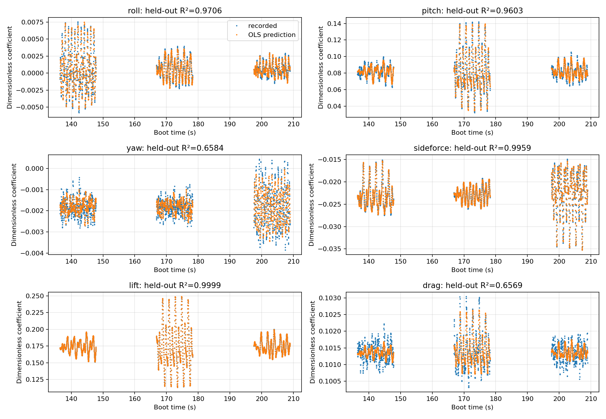

# DDS surface-excitation development

> **DDS default:** `run_mission_SITL.py --interface dds` now loads the packaged
> `straight_flight_sitl.json` automatically. MAVROS is required: defaults target
> 75 m above home, 23 m/s, and the current ground course, then wait for settling.
> `--straight-flight PATH` overrides these settings; `--no-straight-flight`
> explicitly disables navigation coordination and automatic LOITER recovery.
> The shared HITL DDS entrypoint has the same default and retains its RC gate;
> the packaged settings remain SITL examples, not validated physical-flight settings.
> The legacy trajectory interface is unchanged. Rebuild/restart the ROS service
> before using this new default; do not restart it during a running experiment.


For the detailed package guide, see [Surface excitation](ros2_sid/README_surface_excitation.md).

For automatic mission loading and creating your own chirps/multisines, see [Custom DDS waveforms](ros2_sid/docs/custom_surface_waveforms.md).

The shared DDS backend is selected from `run_mission_SITL.py` or
`run_mission_HITL.py` with `--interface dds`. The legacy trajectory backend retains
its existing behavior. Architecture, C4 diagrams, usage, build instructions and
experiment evidence are in `ardupilot_sid/docs/control_surface_excitation/` in the
outer workspace.

For a hands-on walkthrough, see [Run the DDS surface-excitation SITL tests yourself](ros2_sid/docs/manual_surface_excitation_sitl.md). It covers setup, the six single-axis maneuver tests, interactive maneuver control, ROS bags, and plotting.

To enter the container and send waveforms directly, follow [Manual container waveform commands](ros2_sid/docs/manual_container_waveforms.md).

## Automatic ROS setup

After building the DDS-enabled Plane binary, run from the outer workspace:

```bash
docker compose -f docker-compose.sid.yaml up -d --wait --wait-timeout 900
```

The ROS service builds the interfaces and mission packages and runs the surface
Python tests before becoming healthy. See the manual guide for logs and rebuilding
an already running service after source changes.

## Module responsibilities

- `surface_signals.py`: validated waveform definitions, monotonic cadence, clock
  synchronization and RC authorization. Pure Python; no ROS dependency.
- `surface_mission.py`: ROS endpoints, publisher-epoch acknowledgment, experiment
  selection and shutdown. Console input queues events; the timer owns mission state.
- `surface_bag.py`: offline rosbag2 deserialization and clock-domain conversion.
  It never replays commands to an aircraft.
- `surface_analysis.py`: calibrated PWM checks, complete-maneuver validation,
  DataFlash comparison, aligned response export and PNG/PDF figures.
- `surface_axis_plots.py`: six single-axis chirp/multisine report figures from a
  validated ROS bag, with checks that other axes and surfaces remain unexcited.

Public classes/functions have docstrings and type annotations. `WaveformSpec`
describes JSON waveform fields and `AxisSample` fixes the roll/pitch/yaw tuple
shape. Heterogeneous decoded DataFlash/ROS record dictionaries use `Any` at the
serialization boundary; numerical helpers and stateful publisher interfaces are
typed. Dynamic ROS-generated classes have no complete local typing stubs.

## Quality checks

Run from this ROS package directory using a development environment with Ruff and
mypy installed:

```bash
python3 -m ruff check --select E,F,I,ANN,D --ignore E501,D203,D213 \
  ros2_sid/surface*.py scripts/plot_surface_excitation.py
python3 -m ruff format --check ros2_sid/surface*.py \
  scripts/plot_surface_excitation.py tests/test_surface*.py
python3 -m mypy --strict --allow-subclassing-any --ignore-missing-imports \
  --follow-imports=skip ros2_sid/surface*.py
```

The mypy subclass allowance accommodates the external, untyped `rclpy.node.Node`
base class. It does not disable annotation checks on the new modules. Imports are
skipped because firmware-generated ROS interfaces and ROS itself are supplied by
the sourced ROS environment; runtime ROS tests cover those boundaries.

After sourcing ROS Humble and the built workspace:

```bash
python3 -m pytest tests/test_surface_signals.py tests/test_surface_analysis.py \
  tests/test_surface_mission_ros.py
```

The same three suites are registered with `ament_cmake_pytest` for `colcon test`.
A run that skips ROS tests because `rclpy` is unavailable is not a complete test
result. SITL acceptance also validates actual actuator outputs, full waveform
coverage, clock/sequence safeguards and recorded bag/DataFlash agreement.

## Individual-axis flight plots

The SITL runner can execute chirp and multisine separately on roll, pitch and yaw.
From the outer workspace, with the isolated ROS container and agent running:

```bash
python3 ardupilot_sid/Tools/ros2/ardupilot_dds_tests/scripts/surface_sitl.py \
  --individual-axes --rate 50 --output sid_results/individual_axes
```

After building/sourcing the ROS package, regenerate the six detailed figures from
the recorded bag (paths below assume the container's `/work` mount):

```bash
python3 -m ros2_sid.surface_axis_plots \
  --run /work/sid_results/individual_axes \
  --output /work/ardupilot_sid/docs/control_surface_excitation/figures/individual_axes
```

The renderer requires the run's successful output-validation report and all six
command CSV/experiment JSON files. It writes PNG/PDF pairs and `summary.json`.
Each plot shows the selected command and applied logical excitation, physical PWM
perturbations, all three body rates, and the selected axis's unwrapped attitude change. Normal GUIDED
motion remains in the response; nonzero cross-axis response is not evidence that
another excitation axis was commanded. The figures are embedded in the firmware
`VERIFICATION.md` report.

## Shared legacy/DDS mission library

Both backends resolve `ros2_sid/setup/mission_library/current_mission.json` and its
`subfolder`. The selected folder contains `mission_plan.json` with ordered
`filename`/`name`/`order` entries and maneuver CSVs. DDS requires the additional
plan marker `"units": "normalized_surface"`. The default selection is now
`dds_surface`; select `mission_1` for legacy trajectory operation. Backend checks
prevent interpreting surface fractions as legacy attitude commands or vice versa.
Run `run_mission_SITL.py --interface dds` with no source argument for the default.
See the custom-waveform guide for generating CSVs and switching missions.

## Select a recording directory

Inside the container, select an existing interactive SITL run without copying its
timestamp:

```bash
source /work/tools/sid/use_run.sh --latest interactive_
```

For a new waveform session, use `--new container_waves` once, then
`--latest container_waves_` in other shells. Check the printed path; `--path DIRECTORY`
selects an exact existing run. Always use `source` so the helper exports `RUN`
into the shell where you will record, publish, or analyze.


## Default straight-flight coordination

See [straight-flight setup and safe exit](ros2_sid/docs/straight_flight_plan.md) for the
`--straight-flight` option shared by the SITL/HITL DDS entrypoints. It uses MAVROS
for fixed navigation targets and settling, then the existing DDS waveform path.
Normal completion and manual exit observe zero perturbation before requesting
LOITER, while preserving operator/failsafe mode changes. Bag-based plots include
course, altitude, airspeed, phases, and ground track. Physical flight is unverified.

## Cube Orange Plus installation

For hardware builds, USB DDS, flashing and restoring standard ArduPlane, see
[Cube Orange Plus Simulation on Hardware](ros2_sid/docs/cubeorangeplus_simulation_on_hardware.md).
The guide distinguishes firmware installation from loading a parameter file.

For the RC-gated HITL entrypoint, see [manual HITL excitation](ros2_sid/docs/manual_surface_excitation_hitl.md)
and its [implementation/test plan](ros2_sid/docs/hitl_excitation_plan.md).

## OLS comparison against the SITL aircraft

See the [full SITL OLS identification report](ros2_sid/docs/sitl_ols_identification_report.md)
for the experiment design, equations, complete limitations and implementation changes.



This truth-assisted plot shows coefficient predictions at recorded states, not
a free-running trajectory. The three multisine maneuvers were excluded from
training. [Download the PDF](ros2_sid/docs/figures/sitl_ols/held_out_predictions.pdf).

`python3 -m ros2_sid.sitl_ols` fits aerodynamic force and moment coefficients
from a validated six-maneuver conventional-plane run. It uses this package's
`ordinary_least_squares`, fitting the three chirps and reserving all three
multisines for validation. Reference coefficients are read from
`ardupilot_sid/libraries/SITL/SIM_Plane.h` **after** fitting, for comparison only.

With the isolated compose services healthy, run from the outer workspace:

```bash
python3 ardupilot_sid/Tools/ros2/ardupilot_dds_tests/scripts/surface_sitl.py \
  --container surface-excitation-sitl-ros-1 --individual-axes --rate 50 \
  --output sid_results/ols_new_run

docker exec -e PYTHONPATH=/work/ros2_sid/ros2_sid \
  surface-excitation-sitl-ros-1 python3 -m ros2_sid.sitl_ols \
  --run /work/sid_results/ols_new_run \
  --reference /work/ardupilot_sid/libraries/SITL/SIM_Plane.h \
  --state-source truth --include-transients \
  --output /work/sid_results/ols_new_run/ols_truth_transients
```

Use a new output directory for each flight. To repeat the lower-frequency
comparison, add `--waveform-config-dir ros2_sid/ros2_sid/config/surface_excitation/ols`
to the flight command. That directory contains 30-second, 0.1–0.8 Hz chirps and separate 0.1/0.3/0.6 Hz multisines.
The command above uses the original, shorter, higher-frequency examples.
The flight runner leaves normal GUIDED navigation active during excitation.

Outputs are `results.json`, `coefficients.csv`, `regression_data.npz`, and held-out
prediction plots in PNG/PDF. The example derives rates and accelerations from
logged simulator attitude/velocity. Repeat with `--state-source imu` and a new
output directory to compare primary-IMU measurements. `--include-transients`
adds the airborne climb and settling samples to training, excluding each entire
multisine and its filter guard. Omit it to fit only chirps. Broader alpha coverage
was essential to recovering the individual pitch derivatives in these runs.

Both modes use simulator truth for angle of attack and sideslip, assume zero
wind and known geometry/mass/CG/thrust calibration, and reconstruct the default
one-pole servo dynamics from recorded applied PWM. They are simulation
benchmarks, not sensor-only flight estimators. Importing OLS no longer requires
an interactively generated Fourier configuration; Fourier defaults are loaded
only when a transform without explicit frequencies is instantiated.

The model follows the local simulator's conventions:

- Body axes are forward/right/down, angles and body rates are radians.
- Surface input is `(PWM - 1500) / 500`, followed by `SIM_SERVO_SPEED` filtering.
  The `delta*_max` constants in the header are not applied by this simulator.
- `beta = atan2(v, u)`. This fork uses equivalent airspeed together with density
  at AMSL in its force equations; the estimator reproduces that convention.
- `SIM_Plane` integrates its calculated moments directly as angular acceleration.
  Do not introduce a physical aircraft inertia matrix into this comparison.
- Subtract `CGOffset × aerodynamic_force` before fitting moment coefficients;
  remove thrust from body force before calculating lift/drag.
- Drag is fitted as a quadratic in alpha. Its comparison values are the expansion
  of the simulator's induced-drag equation, not three independent header constants.

Training and validation are separated by whole maneuvers using firmware sequence
receipts. A 0.3-second edge exclusion prevents the symmetric numerical filter
from reaching outside each selected maneuver. Reports include regressor rank
and scaled condition number. A high prediction R² alone does **not** demonstrate
accurate coefficients: correlated closed-loop regressors and timing errors can
produce biased derivatives, especially in pitch. Validation evaluates predicted
coefficients at recorded states; it is not a free-running trajectory rollout.

Numerical regression, rank failure, servo scaling/lag and maneuver-selection tests:

```bash
PYTHONPATH=ros2_sid/ros2_sid python3 -m pytest \
  ros2_sid/ros2_sid/tests/test_sitl_ols.py
```

### Measured results, 22 October 2026

Two fresh SITL flights completed all six maneuvers, the safety probe, and bag vs
DataFlash validation. The primary result is
[`ols_identification_20261022/ols_truth_transients`](../sid_results/ols_identification_20261022/ols_truth_transients/results.json):
7,118 training samples and 1,708 held-out samples at 50 Hz. These samples are
temporally correlated, not independent repetitions. No reference aerodynamic
coefficients were fixed in the regressions.

| Coefficient | Hard-coded | OLS | Absolute relative error |
|---|---:|---:|---:|
| `c_lift_0` | 0.56 | 0.56631 | 1.13% |
| `c_lift_a` | 6.9 | 7.01741 | 1.70% |
| `c_l_p` | -1 | -0.98223 | 1.78% |
| `c_l_deltaa` | 0.25 | 0.24443 | 2.23% |
| `c_m_0` | 0.045 | 0.04666 | 3.68% |
| `c_m_a` | -0.7 | -0.66157 | 5.49% |
| `c_m_q` | -20 | -19.31486 | 3.43% |
| `c_m_deltae` | 1 | 0.98806 | 1.19% |
| `c_y_b` | -0.98 | -0.98496 | 0.51% |
| `c_y_deltar` | -0.2 | -0.20143 | 0.71% |

Held-out coefficient-prediction R²: roll 0.971, pitch 0.960, yaw 0.658,
side force 0.996, lift 0.99985, drag 0.657. This is a partial identification
success: yaw derivatives have roughly 13–60% error, roll/yaw-rate coupling
`c_l_r` has 12% error, and several reference-zero derivatives are not recovered
accurately (for example `c_lift_q` estimates 1.97 instead of zero). The complete
CSV/JSON reports preserve these failures rather than showing only the table above.

The lower-frequency flight is preserved in
[`ols_low_frequency_20261022`](../sid_results/ols_low_frequency_20261022/ols_truth_transients/results.json).
It gives a similar lift/pitch result with expanded training, but poorer yaw
validation (R² 0.059). Chirp-only fits and IMU-output variants are saved alongside
both flights. All variants use truth alpha/beta; none establishes sensor-only
identification or a validated free-running aircraft model.
