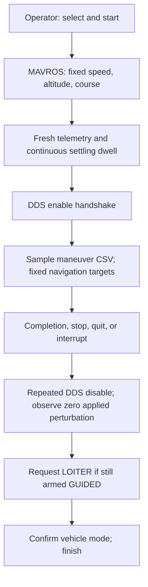

# Straight-flight DDS excitation

The optional ROS coordinator is implemented. It commands fixed course, altitude,
and airspeed through MAVROS, waits for a continuous settling dwell, and then runs
the existing DDS maneuver. Verification results and limitations are tracked in
`ardupilot_sid/docs/control_surface_excitation/VERIFICATION.md`.

No firmware, servo mixing, DDS message, or mission-library format change is needed.
The new option is shared by `run_mission_SITL.py` and `run_mission_HITL.py`.
HITL retains its RC switch gate; physical flight has not been validated.

## Run a simulated straight segment

Start SITL, its DDS agent, the ROS workspace, and an all-topic recorder as described
in [the manual](manual_surface_excitation_sitl.md). The following commands run
inside the sourced ROS container, with the repository mounted at `/work`:

```bash
SHARE="$(ros2 pkg prefix --share ros2_sid)"
bash /work/useful_shell_scripts/run_live.sh --detach \
  --fcu-url 'udp://:14552@127.0.0.1' \
  --mavros-config "$SHARE/config/surface_excitation/mavros_straight.yaml"

# Request position telemetry on this MAVROS connection. The coordinator requires
# fresh position/velocity; ArduPlane's default 1 Hz is insufficient.
ros2 service call /mavros/set_stream_rate mavros_msgs/srv/StreamRate \
  '{stream_id: 6, message_rate: 10, on_off: true}'

ros2 run ros2_sid run_mission_SITL.py --interface dds \
  --straight-flight "$SHARE/config/surface_excitation/straight_flight_sitl.json" \
  --wait-timeout 180 --command-log "$RUN/straight-commands.csv"
```

Use the endpoint from your SITL launcher; the isolated automated test uses TCP
5782 instead. Do not start a second MAVROS instance on an occupied endpoint.
Do not use `--with-drone` or another guidance publisher at the same time.

Take off and enter GUIDED using the existing operator workflow. The coordinator
never arms, takes off, or forces GUIDED. Use `list`, `select N`, and `start` to run
the selected legacy-layout CSV. Neither `--experiment` nor `--mission-plan` is
required. Omitting `--straight-flight` preserves the existing DDS workflow.

The example configuration is for SITL: 100 m above home, 18 m/s airspeed, captured
current ground course, three seconds of continuous settling. Copy the JSON to
change explicit targets/tolerances; these values are not aircraft-independent
flight-test settings. Position stream requests apply to the current MAVLink link.
Check that telemetry is arriving before starting.

## Command and state behavior

The adapter sends one acknowledged command each for speed (43000), relative
altitude (43001), and ground course (43002). It uses this fork's COMMAND_LONG
conversion to GLOBAL_RELATIVE_ALT. Course is true north clockwise; ENU velocity
is converted using `atan2(east, north)`. Heading command parameter 3 is lateral
acceleration in m/s², not degrees/s. The SITL altitude command uses `climb_rate_m_s: 0` (firmware
maximum target slew), while TECS retains its normal limits. In this fork a small
nonzero value advances the interim target from current altitude each cycle and
can cause extremely slow settling. Rejected or missing ACKs abort setup.



Phases are WAITING, COMMANDING, SETTLING, READY, ACTIVE, RETURNING, RECOVERY, DONE.
Settling checks course, bank, angular rates, altitude, airspeed, and climb rate.
The dwell resets whenever any criterion fails. Waveform time starts after READY.
During ACTIVE, a wider flight envelope applies and navigation targets remain
fixed. Normal guidance and stabilization remain running, so the response need
not be perfectly straight or level during excitation.

## Safe exit and legacy behavior

Legacy `maneuver_stop()` stopped signal publishing and reset the maneuver; it did
not explicitly request LOITER. This implementation preserves revocation of
publishing and adds a bounded navigation handoff for the new straight-flight option:

1. `stop`, `quit`, EOF, Ctrl-C, SIGTERM, normal completion, and handled execution
   failures revoke the maneuver and cancel pending setup work.
2. Send repeated DDS disable messages. Firmware handles its configured return ramp
   or immediate removal when authorization is lost.
3. Wait for a fresh `/ap/sid/output` sample received after stopping with zero applied
   normalized excitation and zero physical PWM contribution.
4. If still connected, armed, and GUIDED, request LOITER once. Confirm the actual
   `/mavros/state` mode; a service response alone is insufficient.
5. If the operator/failsafe already changed mode or disarmed, yield without sending
   another mode request. If confirmation is unavailable for eight seconds in the
   example configuration, report failure and the need for operator intervention.

`stop` returns to the console after recovery; `quit` and Ctrl-C exit after the
handoff. Starting another segment requires the operator to select GUIDED again.
Keep MAVROS, DDS, and recording running until recovery is complete. Do not stop
the container or simulator first. A command already sent cannot be recalled.

SIGKILL, process/host failure, or loss of both communication paths cannot guarantee
LOITER recovery. Firmware timeout removes stale excitation, but a persistent
GUIDED course target may remain. Existing vehicle failsafes and operator authority
remain essential. Recovery LOITER is not a landing or a disarm command.

## ROS commands to physical surfaces

```text
ROS 2 mission selects and samples the maneuver CSV
                    ↓
/ap/sid/control_surface
(normalized roll, pitch, yaw perturbations)
                    ↓
Micro XRCE-DDS Agent → ArduPilot AP_DDS subscriber
                    ↓
Freshness, enable, mode, failsafe, and amplitude checks
                    ↓
Mix logical perturbations into configured physical surfaces
                    ↓
Convert using each servo’s MIN / TRIM / MAX / REVERSED
                    ↓
Add perturbation to normal controller/mixer output
                    ↓
Clamp to servo limits → final actuator outputs
```

The closed-loop controller remains active. For later coefficient identification,
retain the total applied surface command as well as the injected signal, baseline,
and aircraft response. PWM represents commanded output, not measured surface angle.
Only the settled ACTIVE window is an identification candidate; exclude setup,
turning, ramp-out, recovery, and aborted segments.

## Record, replot, and test

The all-topic bag includes `/sid/straight_flight` JSON events plus MAVROS navigation
and DDS output. A companion `<command-log>.straight.jsonl` is also written. Events
include timestamps, targets/configuration, phase, response, and receipt ages.

After closing the recorder:

```bash
ros2 run ros2_sid plot_surface_excitation.py "$RUN/rosbag" \
  --output "$RUN/plots" --straight-flight \
  --command-log "$RUN/straight-commands.csv"
```

This reads the bag offline, without replaying commands. It saves the existing
command/applied/PWM/response plots, `straight_navigation.png/pdf`, ground track
`straight_track.png`, exported events, and a navigation summary. Navigation plots
are evidence, not an automatic flight-readiness certification.

Unit/ROS tests cover command ACKs, continuous dwell, course wraparound, telemetry
loss, console shutdown, return-to-zero gating, recovery mode confirmation, and
operator mode precedence. The SITL runner supports `--interactive-library
--straight-flight`, plus `--exit-active quit`, `stop`, or `sigint` / `sigterm` for explicit
mid-maneuver shutdown tests. It uses separate ports/domain, requests 10 Hz position
telemetry, records the bag and .BIN, and checks actual applied outputs. See the
verification report for executed results, failed attempts, and artifact paths.

Verified in SITL: all six full single-axis chirp/multisine maneuvers and six
interrupted maneuvers (console quit/stop, SIGINT, SIGTERM) completed the recorded
zero-output-to-LOITER handoff. The corrected safety probe and bag/DataFlash checks
also passed. See the verification report for failures retained during development
and the limits of these simulation results.
