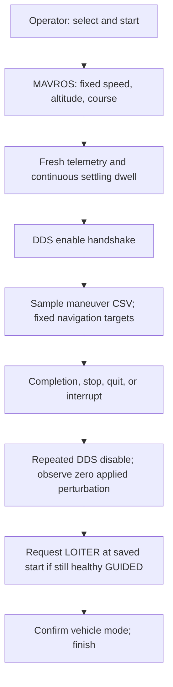

# Straight-flight DDS excitation

> **DDS default:** `run_mission_SITL.py --interface dds` now loads the packaged
> `straight_flight_sitl.json` automatically. MAVROS is required: defaults target
> 100 m above home, 23 m/s, and the current ground course, then wait for settling.
> `--straight-flight PATH` overrides these settings; `--no-straight-flight`
> explicitly disables navigation coordination and automatic LOITER recovery.
> The shared HITL DDS entrypoint has the same default and retains its RC gate;
> the packaged settings remain SITL examples, not validated physical-flight settings.
> The legacy trajectory interface is unchanged. Rebuild/restart the ROS service
> before using this new default; do not restart it during a running experiment.


The ROS coordinator is implemented and enabled by default for DDS missions. It commands fixed course, altitude,
and airspeed through MAVROS, waits for a continuous settling dwell, and then runs
the existing DDS maneuver. Verification results and limitations are tracked in
`ardupilot_sid/docs/control_surface_excitation/VERIFICATION.md`.

No firmware, servo mixing, DDS message, or mission-library format change is needed.
The new option is shared by `run_mission_SITL.py` and `run_mission_HITL.py`.
HITL retains its RC switch gate; physical flight has not been validated.

## Run a simulated straight segment

Start SITL, its DDS agent, the ROS workspace, and an all-topic recorder as described
in [the manual](manual_surface_excitation_sitl.md). The following commands run
inside the sourced ROS container, with the repository mounted at `/work`:

```bash
SHARE="$(ros2 pkg prefix --share ros2_sid)"
bash /work/useful_shell_scripts/run_live.sh --detach \
  --fcu-url 'udp://:14552@127.0.0.1' \
  --mavros-config "$SHARE/config/surface_excitation/mavros_straight.yaml"

# Request position telemetry on this MAVROS connection. The coordinator requires
# fresh position/velocity; ArduPlane's default 1 Hz is insufficient.
ros2 service call /mavros/set_stream_rate mavros_msgs/srv/StreamRate \
  '{stream_id: 6, message_rate: 10, on_off: true}'

ros2 run ros2_sid run_mission_SITL.py --interface dds \
  --wait-timeout 180 --command-log "$RUN/straight-commands.csv"
```

Use the endpoint from your SITL launcher; the isolated automated test uses TCP
5782 instead. Do not start a second MAVROS instance on an occupied endpoint.
Do not use `--with-drone` or another guidance publisher at the same time.

Take off and enter GUIDED using the existing operator workflow. The coordinator
never arms, takes off, or forces GUIDED. Use `list`, `select N`, and `start` to run
the selected legacy-layout CSV. Neither `--experiment` nor `--mission-plan` is
required. Straight-flight coordination is enabled by default. Use `--no-straight-flight`
for excitation-only behavior without navigation targets or LOITER recovery.

The example configuration is for SITL: 100 m above home, 23 m/s airspeed, captured
current ground course, 0.25 seconds of continuous settling. Copy the JSON to
change explicit targets/tolerances; these values are not aircraft-independent
flight-test settings. Position stream requests apply to the current MAVLink link.
Check that telemetry is arriving before starting.

## JSON parameter reference

Configuration: [straight_flight_sitl.json](../config/surface_excitation/straight_flight_sitl.json).
The values below reflect the current source example, not hard-coded defaults or
validated settings for every aircraft. The DDS SITL and HITL entrypoints load the
installed copy by default. Use `--straight-flight PATH` to load a specific file;
restart the mission after editing it. Rebuild/install when using an installed
copy, and relaunch when using a launcher snapshot.

### Navigation targets

These settings command the aircraft during setup. Disabling a tolerance does not
remove the associated navigation command.

| Parameter | Example value | Units and behavior | Meaning of `null` |
|---|---|---|---|
| `course_deg` | `null` | Ground-track direction clockwise from true north: 0 = north, 90 = east, 180 = south, 270 = west. A number must be in `[0, 360)`. This is ground course, not aircraft yaw. | Capture the current ground course once valid setup telemetry is available, before sending navigation commands; retain it for this maneuver. Omitting this key has the same effect. |
| `altitude_relative_m` | `100` | Target altitude in meters above home, not above terrain or sea level. Must be positive. | Not allowed. |
| `airspeed_m_s` | `23` | Target airspeed in m/s, not groundspeed. Must be positive and strictly inside each enabled airspeed envelope bound. | Not allowed, even if all airspeed checks are disabled. |
| `heading_accel_m_s2` | `2` | Positive lateral acceleration in m/s² passed to the ground-course command to control the turn toward the target. It is not a heading rate in degrees/s. | Not allowed. |
| `climb_rate_m_s` | `0` | Nonnegative altitude-target slew-rate argument in m/s. Zero selects the firmware maximum; it does not command zero climb. Normal TECS limits still apply. | Not allowed. |

### Settling before excitation

All enabled tolerances must pass continuously for `dwell_s` before the coordinator
becomes READY. A failed tolerance resets the dwell timer. A value exactly at a
tolerance passes. These are settling requirements, separate from the wider
READY/ACTIVE envelope below.

| Parameter | Example value | Units and comparison | Meaning of `null` |
|---|---|---|---|
| `dwell_s` | `0.25` | Positive seconds for which all enabled settling checks must continuously pass. Still required when all tolerances are disabled. | Not allowed. |
| `course_tolerance_deg` | `5` | Maximum absolute shortest-angle error in degrees between measured ground course and target course; wraps across north. | Skip course settling. |
| `bank_tolerance_deg` | `5` | Maximum absolute roll/bank angle in degrees relative to wings level. | Skip bank settling. |
| `rate_tolerance_rad_s` | `0.15` | Maximum absolute angular rate across all reported roll, pitch, and yaw rates, in rad/s. Every component must meet this limit. | Skip angular-rate settling. |
| `altitude_tolerance_m` | `10` | Maximum absolute altitude error in meters relative to `altitude_relative_m`. | Skip altitude settling. |
| `airspeed_tolerance_m_s` | `5` | Maximum absolute airspeed error in m/s relative to `airspeed_m_s`. | Skip airspeed settling. |
| `climb_tolerance_m_s` | `1.5` | Maximum absolute vertical velocity in m/s; checks closeness to level flight, not closeness to `climb_rate_m_s`. | Skip climb settling. |

For example, target airspeed 23 with tolerance 5 accepts 18–28 m/s during
settling. The separate envelope below still requires 20–30 m/s in READY/ACTIVE.

### Envelope and planned duration

Enabled envelope limits are checked in both READY and ACTIVE. Exceeding a limit
aborts the maneuver and enters the normal stop/recovery path. Equality with a
limit is allowed. These checks do not replace the settling tolerances.

| Parameter | Example value | Units and behavior | Meaning of `null` |
|---|---|---|---|
| `max_bank_deg` | `55` | Maximum absolute bank angle in degrees. | Skip the bank envelope check. |
| `max_altitude_error_m` | `30` | Maximum absolute altitude error in meters from the commanded altitude. | Skip the altitude envelope check. |
| `max_course_error_deg` | `40` | Maximum absolute shortest-angle course error in degrees from the commanded course. | Skip the course envelope check. |
| `min_airspeed_m_s` | `20` | Minimum measured airspeed in m/s. Checked independently of the upper bound. | Skip the lower airspeed bound. |
| `max_airspeed_m_s` | `30` | Maximum measured airspeed in m/s. Checked independently of the lower bound. | Skip the upper airspeed bound. |
| `max_duration_s` | `30` | Maximum planned experiment duration in seconds, checked before setup begins. Does not include setup or recovery time. | Skip this admission check; the experiment still ends at its own duration. |

All numeric tolerances and envelope/duration limits must be finite and positive.
Their keys must remain in the JSON even when their value is `null`.

### Timeouts and recovery

Timeouts use local monotonic time. Freshness measures time since receipt, rather
than vehicle wall-clock time. None of these settings changes a firmware watchdog.

| Parameter | Example value | Units and behavior | Meaning of `null` |
|---|---|---|---|
| `rc_timeout_s` | `null` | Maximum valid RC sample age in seconds for HITL authorization. Numeric values must be greater than 0 and at most 2. A stale sample revokes authorization and requires another LOW-to-HIGH transition. | Skip RC age checks only. Valid input and LOW-to-HIGH activation remain required; LOW or invalid input still stops. The last valid HIGH remains authorized if messages stop. |
| `setup_timeout_s` | `90` | Positive seconds from setup start, covering WAITING, COMMANDING, SETTLING, and READY until ACTIVE. Exceeding it aborts setup. It is not reset on each phase transition. | Not allowed. |
| `recovery_timeout_s` | `8` | Positive seconds from stop/recovery initiation to confirm the navigation handoff. Includes waiting for zero excitation and LOITER confirmation. Expiry reports recovery unconfirmed; it is not a deadline for physically arriving at the saved location. | Not allowed. |
| `telemetry_timeout_s` | `1` | Positive maximum receipt age in seconds for output, velocity, and altitude telemetry. Also applies to the setup GPS fix, recovery target echo, and zero-output confirmation. Missing or stale telemetry blocks setup or prevents confirmation; loss after setup proceeds aborts the maneuver. | Not allowed. |
| `state_timeout_s` | `3` | Positive maximum age in seconds of `/mavros/state`, used for navigation authorization and recovery decisions. A recent state must still satisfy the separate connection, mode, and system-status requirements. | Not allowed. |
| `recovery_mode` | `"LOITER"` | Required string; only `LOITER` is accepted. After zero excitation is confirmed, request LOITER at the position/altitude saved before setup, if navigation authority is still available. Operator/failsafe mode changes take priority. | Not allowed; other mode strings are also rejected. |

RC timeout precedence is explicit `--rc-timeout` override, then JSON, then the
0.5-second mission fallback if the key is absent. `--rc-timeout null` explicitly
disables it. With `--no-straight-flight`, this JSON is not loaded, so use the CLI
override to change RC freshness. The SITL mission does not use the HITL RC gate.
`--wait-timeout` is a separate mission option, not a replacement for these timers.

### Course example and checks that remain active

With `course_deg: null`, an aircraft tracking east at setup captures 90° as its
target. With `course_tolerance_deg: 5`, settling requires 85–95°. With
`max_course_error_deg: 40`, a deviation greater than 40° triggers an envelope
stop in READY/ACTIVE. Setting both course check values to `null` skips those two
comparisons while still commanding the captured 90° course.

There is no `armed` JSON parameter. The coordinator does not use arming as its
navigation gate. Required valid/finite telemetry, groundspeed above 3 m/s,
healthy GUIDED authorization, command acknowledgements, clock synchronization,
and firmware authorization remain independent of the nullable checks. The
navigation-command ACK timeout is a separate fixed five seconds in the code.
See the HITL manual's [worked null examples](manual_surface_excitation_hitl.md#examples-change-only-the-checks-you-want-to-skip)
for RC, airspeed, bank, and duration changes.

## Command and state behavior

The adapter sends one acknowledged command each for speed (43000), relative
altitude (43001), and ground course (43002). It uses this fork's COMMAND_LONG
conversion to GLOBAL_RELATIVE_ALT. Course is true north clockwise; ENU velocity
is converted using `atan2(east, north)`. Heading command parameter 3 is lateral
acceleration in m/s², not degrees/s. The SITL altitude command uses `climb_rate_m_s: 0` (firmware
maximum target slew), while TECS retains its normal limits. In this fork a small
nonzero value advances the interim target from current altitude each cycle and
can cause extremely slow settling. Rejected or missing ACKs abort setup.



Phases use the `FlightPhase` enum: IDLE, WAITING, COMMANDING, SETTLING, READY,
ACTIVE, RETURNING, RECOVERY, DONE. Logs and JSON retain these names as strings.
Settling applies the enabled checks for course, bank, angular rates, altitude, airspeed, and climb rate.
The dwell resets whenever any criterion fails. Waveform time starts after READY.
During READY and ACTIVE, a wider flight envelope applies and navigation targets remain
fixed. Normal guidance and stabilization remain running, so the response need
not be perfectly straight or level during excitation.

## Safe exit and legacy behavior

Legacy `maneuver_stop()` stopped signal publishing and reset the maneuver; it did
not explicitly request LOITER. This implementation preserves revocation of
publishing and adds a bounded navigation handoff for the new straight-flight option:

1. `stop`, `quit`, EOF, Ctrl-C, SIGTERM, normal completion, and handled execution
   failures revoke the maneuver and cancel pending setup work.
2. Send repeated DDS disable messages. Firmware handles its configured return ramp
   or immediate removal when authorization is lost.
3. Wait for a fresh `/ap/sid/output` sample received after stopping with zero applied
   normalized excitation and zero physical PWM contribution.
4. If still connected, healthy (STANDBY or ACTIVE), and GUIDED, request LOITER at the saved setup-start
   location once. Confirm the actual `/mavros/state` mode and a fresh matching
   `/mavros/setpoint_raw/target_global` echo; a service response alone is insufficient.
5. If the operator/failsafe already changed mode or entered a critical/emergency state, yield without sending
   another mode request. If confirmation is unavailable for eight seconds in the
   example configuration, report failure and the need for operator intervention.

`stop` returns to the console after recovery; `quit` and Ctrl-C exit after the
handoff. Starting another segment requires the operator to select GUIDED again.
Keep MAVROS, DDS, and recording running until recovery is complete. Do not stop
the container or simulator first. A command already sent cannot be recalled.

SIGKILL, process/host failure, or loss of both communication paths cannot guarantee
LOITER recovery. Firmware timeout removes stale excitation, but a persistent
GUIDED course target may remain. Existing vehicle failsafes and operator authority
remain essential. Recovery LOITER is not a landing or a disarm command.

## ROS commands to physical surfaces

```text
ROS 2 mission selects and samples the maneuver CSV
                    ↓
/ap/sid/control_surface
(normalized roll, pitch, yaw perturbations)
                    ↓
Micro XRCE-DDS Agent → ArduPilot AP_DDS subscriber
                    ↓
Freshness, enable, mode, failsafe, and amplitude checks
                    ↓
Mix logical perturbations into configured physical surfaces
                    ↓
Convert using each servo’s MIN / TRIM / MAX / REVERSED
                    ↓
Add perturbation to normal controller/mixer output
                    ↓
Clamp to servo limits → final actuator outputs
```

The closed-loop controller remains active. For later coefficient identification,
retain the total applied surface command as well as the injected signal, baseline,
and aircraft response. PWM represents commanded output, not measured surface angle.
Only the settled ACTIVE window is an identification candidate; exclude setup,
turning, ramp-out, recovery, and aborted segments.

## Record, replot, and test

The all-topic bag includes `/sid/straight_flight` JSON events plus MAVROS navigation
and DDS output. A companion `<command-log>.straight.jsonl` is also written. Events
include timestamps, targets/configuration, phase, response, and receipt ages.

After closing the recorder:

```bash
ros2 run ros2_sid plot_surface_excitation.py "$RUN/rosbag" \
  --output "$RUN/plots" --straight-flight \
  --command-log "$RUN/straight-commands.csv"
```

This reads the bag offline, without replaying commands. It saves the existing
command/applied/PWM/response plots, `straight_navigation.png/pdf`, ground track
`straight_track.png`, exported events, and a navigation summary. Navigation plots
are evidence, not an automatic flight-readiness certification.

Unit/ROS tests cover command ACKs, continuous dwell, course wraparound, telemetry
loss, console shutdown, return-to-zero gating, recovery mode confirmation, and
operator mode precedence. The SITL runner supports `--interactive-library
--straight-flight`, plus `--exit-active quit`, `stop`, or `sigint` / `sigterm` for explicit
mid-maneuver shutdown tests. It uses separate ports/domain, requests 10 Hz position
telemetry, records the bag and .BIN, and checks actual applied outputs. See the
verification report for executed results, failed attempts, and artifact paths.

Verified in SITL: all six full single-axis chirp/multisine maneuvers and six
interrupted maneuvers (console quit/stop, SIGINT, SIGTERM) completed the recorded
zero-output-to-LOITER handoff. The corrected safety probe and bag/DataFlash checks
also passed. See the verification report for failures retained during development
and the limits of these simulation results.


## Tolerance and dwell reference

See the manual's [settling tolerances and active limits](manual_surface_excitation_sitl.md#settling-tolerances-and-active-limits)
for parameter names, numeric ranges, timer reset behavior, and the difference
between settling and active abort checks. The current source configuration uses
a 100 m target, 23 m/s airspeed, and a 0.25-second dwell. Historical SITL verification
used a three-second dwell; its results are not validation of these edited settings.

## Implemented revision: return to the maneuver start

The shared SITL/HITL coordinator captures a fresh GPS fix and relative altitude
before sending its first setup command. Completion and all normal cancellation
paths retain the existing zero-excitation gate, then send COMMAND_INT
NAV_LOITER_UNLIM with the captured location. The Plane handler now validates that
location and fence before changing mode, then installs the target after LOITER
entry. A zero-coordinate command preserves the existing loiter-here behavior.
The coordinator reserves latitude/longitude (0, 0) rather than silently invoking
that behavior. Loiter radius and direction retain the aircraft's existing setup.

MAVROS's setpoint_raw plugin receives POSITION_TARGET_GLOBAL_INT; a fresh matching
target plus a successful service send and LOITER mode confirms handoff.
MAVROS CommandInt reports transmission success, not a command ACK; the target
echo is therefore required. Old firmware
that ignores the requested location cannot pass this check at a different end
point. The eight-second confirmation budget covers the handoff, not transit.
The autopilot finishes the return independently after publisher exit.

Validation includes stale GPS, capture-once/reset-per-maneuver, zero-before-turn,
wrong/stale target echoes, rejected commands, and operator/failsafe precedence.
The SITL harness option `--verify-start-return` additionally records the return
track and requires 15 continuous seconds within 130 m of the saved center while
in LOITER (test-only loiter radius 80 m). Use it with `--straight-flight` or
`--hitl-rc`. This is simulated evidence, not validation on a physical Cube.

Vehicle arming is not a navigation-authorization gate. Disarming alone does not
stop excitation or suppress recovery; mode changes and failsafes still take priority.

## Optional checks in the DDS mission configuration

`config/surface_excitation/straight_flight_sitl.json` now includes
`"rc_timeout_s": null`. This disables RC sample-age checks in the Python mission
coordinator. A valid RC sample and LOW-to-HIGH transition are still required for
HITL activation; LOW or invalid input stops the maneuver. With freshness disabled,
the last valid HIGH remains authorized if RC messages stop arriving.

Use a number in `(0, 2]` to enable the RC timeout in seconds. An explicit
`--rc-timeout 0.5` or `--rc-timeout null` overrides JSON. A missing JSON key, or
`--no-straight-flight` without an override, uses the mission default of 0.5 seconds.
This setting applies to the shared DDS mission path; SITL does not use the HITL
RC activation gate. Firmware authorization and timeouts are independent.

The following JSON settings also accept `null` to skip their own check:

- Settling: `course_tolerance_deg`, `bank_tolerance_deg`, `rate_tolerance_rad_s`,
  `altitude_tolerance_m`, `airspeed_tolerance_m_s`, `climb_tolerance_m_s`.
- Envelope: `max_bank_deg`, `max_altitude_error_m`, `max_course_error_deg`,
  `min_airspeed_m_s`, `max_airspeed_m_s`.
- Planned maneuver duration limit: `max_duration_s`. The experiment still has
  its own duration and completes normally.

All other numeric settings remain required. Telemetry/state freshness, valid
measurements, navigation authorization, setup/recovery deadlines, and dwell still
apply. Disabling every settling tolerance still requires the configured dwell.
Airspeed bounds can be disabled independently. `course_deg: null` retains its
existing meaning: capture the current course. Missing limit/tolerance keys are
configuration errors, not implicit opt-outs.

Startup logs list disabled checks and the effective RC timeout. Straight-flight
JSONL events include the effective configuration, including CLI RC overrides.
